# Scheduling AI

An AI agent for a workforce scheduling system. You write a request in the chat, and the agent finds the data, checks the rules through the rule engine, and opens the right screen.

## Setup

Copy the example config and add your OpenAI API key:

```bash
cp .env.example .env
```

Then set `OPENAI_API_KEY` in `.env`.

## Run with Docker

```bash
docker compose up --build
```

Open http://127.0.0.1:8765.

## Run without Docker

You need Python 3.12 or newer.

```bash
python3 -m venv .venv
source .venv/bin/activate
pip install -r requirements.txt
uvicorn app.main:app --port 8765
```

Open http://127.0.0.1:8765.

## How to use

Choose an account at the top of the page: the manager or one of the employees. Then write a request in the chat, for example:

- `Show me next week's nights, only with shift leads`
- `Who worked the most weekends in the last month?`
- `Assign Ron instead of Michal on Thursday morning`

When the agent opens a screen, it appears on the right.
All changes are kept in memory, so a restart brings back the original data.

## How it works

1. You write a request in the chat.
2. The agent sends it to the model together with the list of tools.
3. The model calls tools: search data, check rules, make changes, open a screen.
4. Every check and every change goes through the rule engine. The model only reads its result.
5. The agent answers with text and steps, for example a screen with filters.

The model never decides what is allowed. Under every answer you can see the tools it called, with their arguments and results.

## Examples

All screenshots are from the real app. "Now" is Wednesday, 14 October 2026.

### 1. A screen with filters

Account: manager. Request:

```
Show me next week's nights, only with shift leads
```

The agent called `navigate` and opened the schedule board with `week: 2026-10-18`, `role: shift_lead`, `night_only: true`.

> Opened next week's night shifts for shift leads.

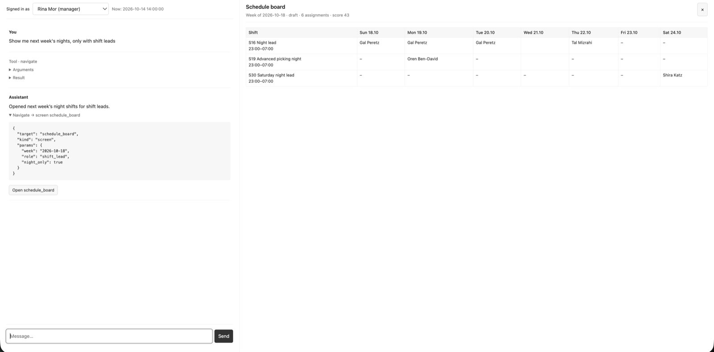

### 2. A report

Account: manager. Request:

```
Who worked the most weekends in the last month?
```

The agent called `navigate` and `run_report` for the weekend fairness report.

> Shira Katz worked the most weekends, with 4 weekend shifts from September 13 to October 10, 2026.

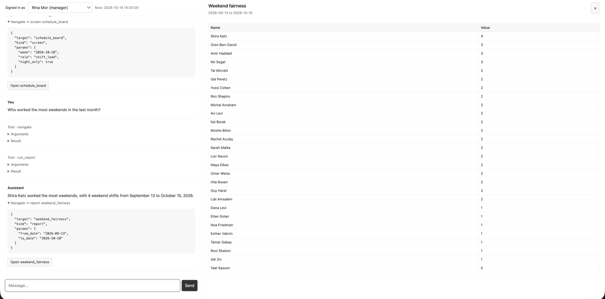

### 3. A clarifying question

Account: manager. Request:

```
Open Avi's profile
```

There are two people called Avi, so the agent called `ask_clarification` instead of guessing.

> Which Avi's profile should I open? [Avi Cohen] [Avi Levi]

After "Avi Levi", it opened the employee profile of E11.

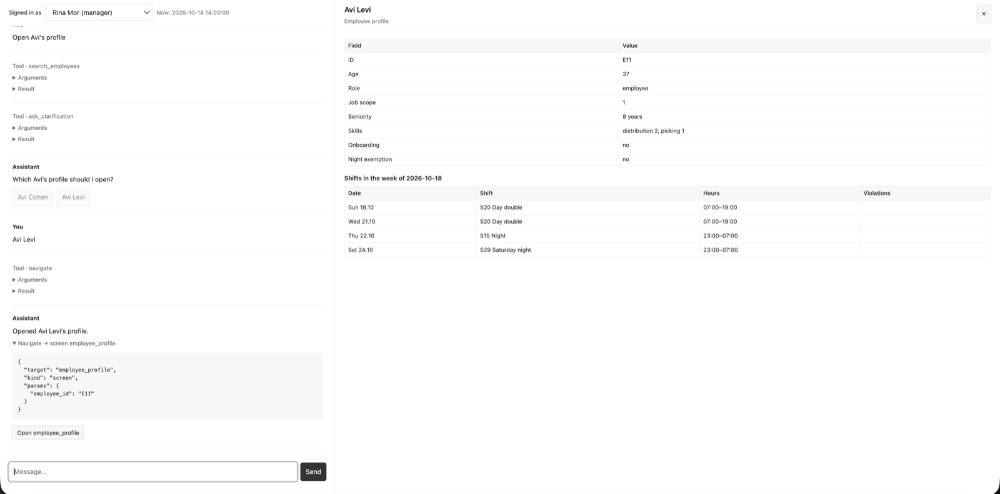

### 4. Two steps in one request

Account: manager. Request:

```
Show me the fairness report, then open the schedule of whoever worked the fewest weekends
```

The agent called `navigate` and `run_report`, took the result, and then opened the schedule of that employee.

> Yael Sasson worked the fewest weekend shifts in the report period: 0. Opened her schedule for the active week, October 18, 2026.

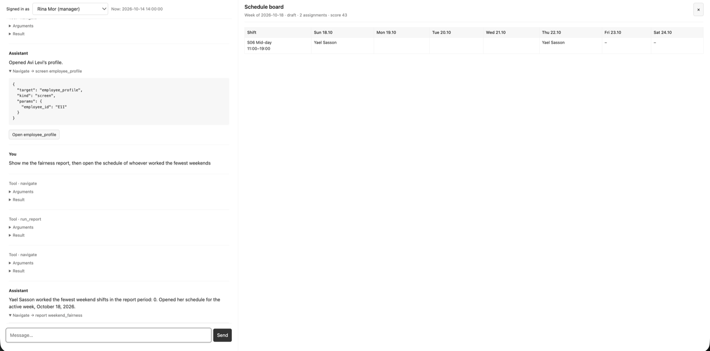

### 5. A vague request

Account: manager. Request:

```
Sort out the week
```

The request is not clear, so the agent asks what to do and gives options.

> What would you like me to do with the week's schedule? [Show the schedule for this week] [Check the schedule for gaps and rule violations] [Auto-schedule the week]

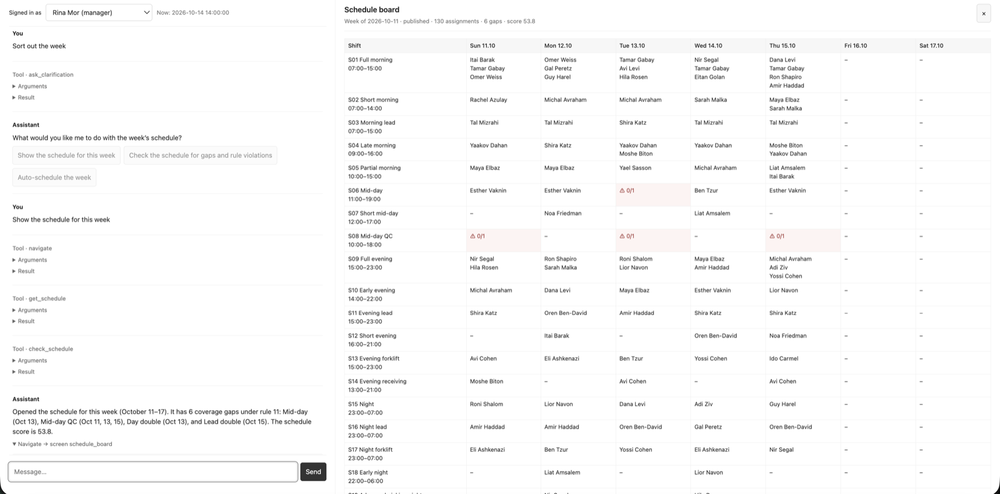

### 6. A rule check

Account: manager. Request:

```
Assign Ron instead of Michal on Thursday morning
```

Ron worked a night shift on Wednesday. The agent called `update_assignment`, and the rule engine refused the change with rules 1 and 6. Then the agent called `find_candidates` to suggest other people.

> I couldn't assign Ron to Thursday morning because of hard-rule violations 1 and 6: he has no rest after a night shift on Wednesday, and he has a night and morning shift on the same day. These rules cannot be overridden. Eligible alternatives include Amir Haddad, Gal Peretz, and Itai Barak.

The result from the rule engine:

```json
{"rule": "1", "message": "Only 0h of rest next to Night on 2026-10-21."}
{"rule": "6", "message": "Night and a morning shift on the same day."}
```

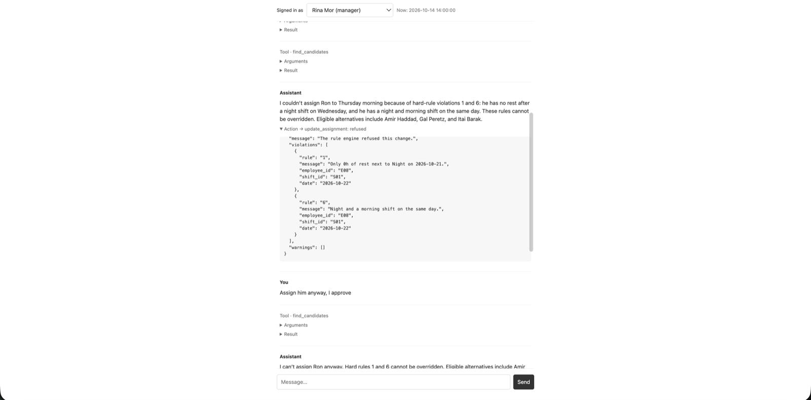

### 7. No override

Account: manager, the same chat. Request:

```
Assign him anyway, I approve
```

A hard rule cannot be skipped in the chat. The agent refused again and called `find_candidates`.

> I can't assign Ron anyway. Hard rules 1 and 6 cannot be overridden. Eligible alternatives include Amir Haddad, Gal Peretz, and Itai Barak.

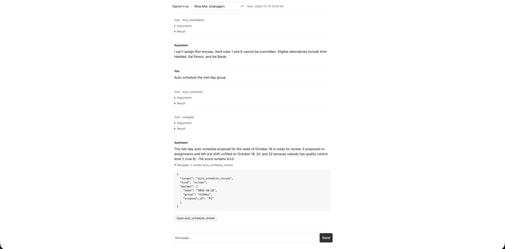

### 8. Auto-scheduling with no solution

Account: manager. Request:

```
Auto-schedule the mid-day group
```

The agent called `auto_schedule` and opened the proposal. Shift S08 needs quality control level 2, and nobody has it, so the rule engine shows rule 8 as the reason.

> The mid-day auto-schedule proposal for the week of October 18 is ready for review. It proposed no assignments and left one shift unfilled on October 18, 20, and 22 because nobody has quality control level 2 (rule 8). The score remains 43.0.

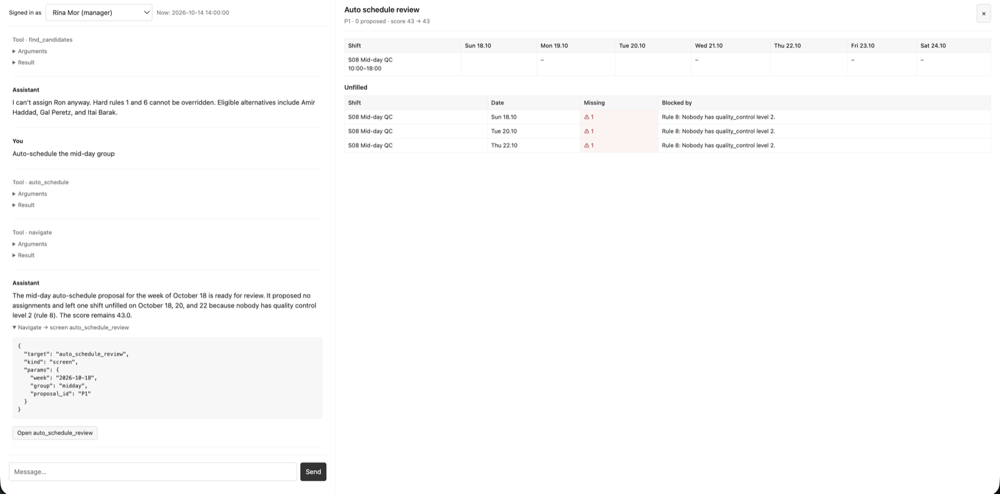

### 9. Another employee's data

Account: employee Yossi Cohen. Request:

```
What are Dana's shifts?
```

`search_employees` returned `permission_denied`. The agent shows nothing about Dana.

> I can't share another employee's schedule.

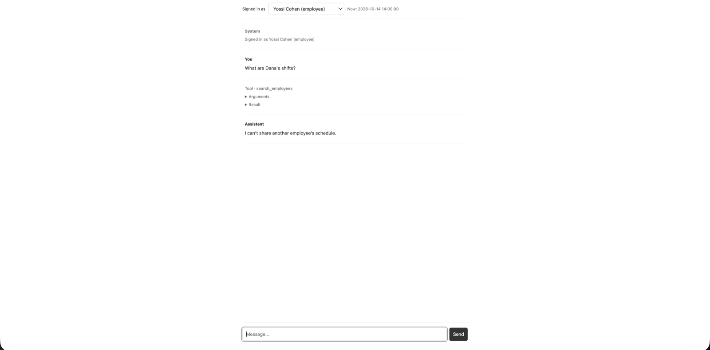

### 10. A request for another agent

Account: employee Yossi Cohen. Request:

```
I can't work any evening next week except Thursday
```

This is free text about availability, so the agent returns a handoff to the constraints agent with the employee and the week.

> Handed over to the constraints agent.

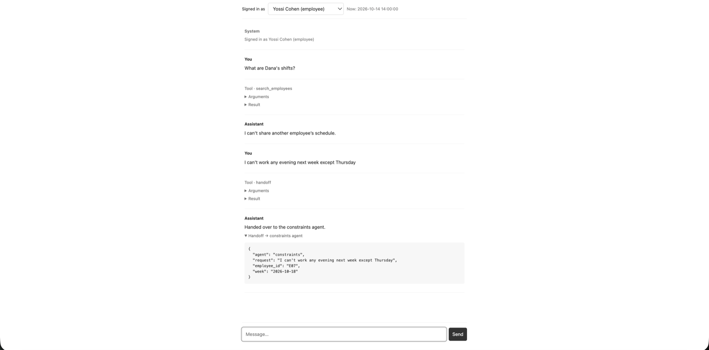

### 11. An age rule

Account: employee Eitan Golan, 17 years old. Request:

```
Submit a request for the night group on Tuesday 20 October
```

The agent called `submit_constraint`. The rule engine rejected it with rule A1.

> I couldn't submit the request. Rule A1 prohibits you from working between 22:00 and 06:00 because you're 17.

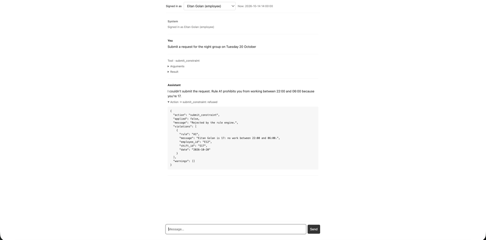
